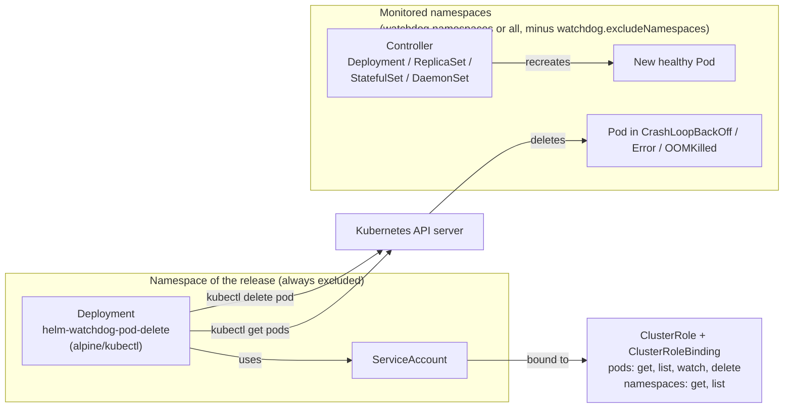
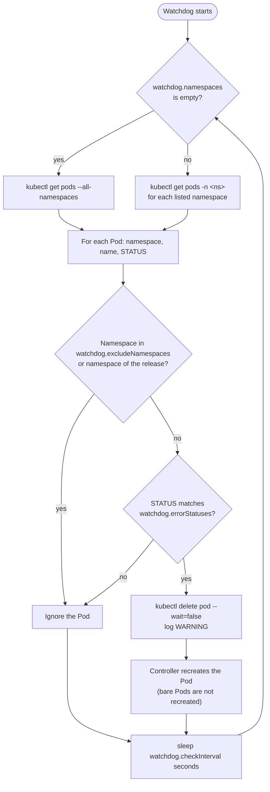

# helm-watchdog-pod-delete

        [](https://tooomm.github.io/github-release-stats/?username=aeciopires&repository=helm-watchdog-pod-delete)

A Helm chart to delete pods with errors

# Table of Contents
<!-- TOC -->

- [helm-watchdog-pod-delete](#helm-watchdog-pod-delete)
- [Table of Contents](#table-of-contents)
- [Prerequisites](#prerequisites)
- [Installing the Chart](#installing-the-chart)
  - [From the OCI registry (recommended)](#from-the-oci-registry-recommended)
  - [From the Helm repository](#from-the-helm-repository)
  - [Verifying the signature of the chart](#verifying-the-signature-of-the-chart)
  - [Testing the Watchdog](#testing-the-watchdog)
  - [Grant Identity Permissions in GKE (Workload Identity)](#grant-identity-permissions-in-gke-workload-identity)
- [Upgrading](#upgrading)
  - [To 1.0.0](#to-100)
- [Uninstalling the Chart](#uninstalling-the-chart)
- [Changelog](#changelog)
- [Motivation and use cases](#motivation-and-use-cases)
  - [Problem Statement](#problem-statement)
  - [Solution](#solution)
  - [Use Cases](#use-cases)
- [How It Works](#how-it-works)
- [Security](#security)
- [Parameters](#parameters)

<!-- TOC -->

# Prerequisites

- Kubernetes 1.34 or newer (`kubeVersion: >=1.34.0-0`)
- Helm 4 (recommended). The chart uses `apiVersion: v2`, so Helm 3 also works.
- To develop and test the chart, see [REQUIREMENTS.md](../../REQUIREMENTS.md) and [examples/README.md](../../examples/README.md).

# Installing the Chart

- Access a Kubernetes cluster.
- Change the values according to the need of the environment in a `values.yaml` file. The [Parameters](#parameters) section lists the parameters that can be configured during installation.

## From the OCI registry (recommended)

Show the chart information:

```bash
helm show chart oci://ghcr.io/aeciopires/helm-charts/helm-watchdog-pod-delete --version 1.0.0
```

Test the installation:

```bash
helm upgrade --install helm-watchdog-pod-delete oci://ghcr.io/aeciopires/helm-charts/helm-watchdog-pod-delete \
  --version 1.0.0 \
  -f values.yaml \
  -n helm-watchdog-pod-delete --create-namespace \
  --dry-run=server
```

Install/upgrade the chart with the release name `helm-watchdog-pod-delete`:

```bash
helm upgrade --install helm-watchdog-pod-delete oci://ghcr.io/aeciopires/helm-charts/helm-watchdog-pod-delete \
  --version 1.0.0 \
  -f values.yaml \
  -n helm-watchdog-pod-delete --create-namespace \
  --wait --rollback-on-failure
```

> `--rollback-on-failure` is the Helm 4 name of the Helm 3 flag `--atomic`.

## From the Helm repository

```bash
helm repo add helm-watchdog-pod-delete https://aeciopires.github.io/helm-watchdog-pod-delete
helm repo update
helm search repo helm-watchdog-pod-delete/helm-watchdog-pod-delete -l

helm upgrade --install helm-watchdog-pod-delete helm-watchdog-pod-delete/helm-watchdog-pod-delete \
  --version 1.0.0 \
  -f values.yaml \
  -n helm-watchdog-pod-delete --create-namespace \
  --wait --rollback-on-failure
```

## Verifying the signature of the chart

The chart published in the OCI registry is signed with [cosign](https://docs.sigstore.dev/) (keyless) by the GitHub Actions workflow of this repository:

```bash
cosign verify ghcr.io/aeciopires/helm-charts/helm-watchdog-pod-delete:1.0.0 \
  --certificate-identity-regexp '^https://github.com/aeciopires/helm-watchdog-pod-delete/\.github/workflows/release\.yml@refs/tags/' \
  --certificate-oidc-issuer https://token.actions.githubusercontent.com
```

## Testing the Watchdog

Validate the RBAC permissions of the watchdog:

```bash
helm test helm-watchdog-pod-delete -n helm-watchdog-pod-delete --logs
```

Create a crashed Pod to see if the watchdog works correctly:

```bash
kubectl create namespace test-crash
kubectl run test-crash --image=busybox:1.37.0 --restart=Never -n test-crash -- /bin/sh -c "exit 1"
```

See logs of watchdog pod with the follow command:

```bash
kubectl logs -f deploy/helm-watchdog-pod-delete -n helm-watchdog-pod-delete
```

If everything is ok, the watchdog will display:

```bash
2026-11-08T15:10:20Z [INFO] Starting the watchdog...
2026-11-08T15:10:20Z [INFO] Namespaces: <all>
2026-11-08T15:10:20Z [INFO] Excluded namespaces: helm-watchdog-pod-delete default kube-system ...
2026-11-08T15:10:20Z [INFO] Error statuses: CrashLoopBackOff|Error|OOMKilled
2026-11-08T15:10:20Z [INFO] Check interval: 120s
2026-11-08T15:10:20Z [INFO] Monitoring pods with errors...
2026-11-08T15:12:20Z [WARNING] Deleting pod: test-crash in namespace: test-crash (status: Error)
```

To test everything locally (kind + ArgoCD + local chart), see [examples/README.md](../../examples/README.md).

## Grant Identity Permissions in GKE (Workload Identity)

In GKE, access to the cluster may be managed by Workload Identity (instead of the default Kubernetes ServiceAccounts).

To fix this:

- Enable Workload Identity (if required)
- If Workload Identity is enabled in GKE, the Kubernetes ServiceAccount must be linked to a Google Cloud ServiceAccount:

```bash
# Link the Kubernetes ServiceAccount to the GCP ServiceAccount
gcloud iam service-accounts add-iam-policy-binding \
GCP_SERVICE_ACCOUNT@PROJECT.iam.gserviceaccount.com \
--role roles/iam.workloadIdentityUser \
--member "serviceAccount:PROJECT.svc.id.goog[helm-watchdog-pod-delete/helm-watchdog-pod-delete]"
```

- Replace:
  - GCP_SERVICE_ACCOUNT with the Google Cloud ServiceAccount.
  - PROJECT with your project ID.

- This allows the container to use correct credentials within the cluster.

# Upgrading

## To 1.0.0

This is a major release with breaking changes. Review your values before upgrading:

- Kubernetes >= 1.34 is required.
- The container runs as non-root with read-only root filesystem by default (`podSecurityContext` and `securityContext`).
- `serviceAccount.automount` defaults to `false`. The token is mounted by the `kube-api-access` projected volume. If you removed this volume from `volumes`, set `serviceAccount.automount=true`.
- `image.tag` defaults to `""` (uses `appVersion`).
- ClusterRole/ClusterRoleBinding are controlled by `rbac.create` and named after the release fullname.
- The namespace of the release is always excluded from monitoring.

See all changes in [CHANGELOG.md](../../CHANGELOG.md).

# Uninstalling the Chart

To uninstall/delete the `helm-watchdog-pod-delete` deployment:

```bash
helm uninstall helm-watchdog-pod-delete -n helm-watchdog-pod-delete
```

# Changelog

See [CHANGELOG.md](../../CHANGELOG.md) and https://github.com/aeciopires/helm-watchdog-pod-delete/releases

# Motivation and use cases

## Problem Statement

In Kubernetes, applications running as Pods may sometimes enter an undesired state such as ``CrashLoopBackOff`` or ``Error`` (for example). This can happen due to various reasons like memory leaks, unhandled exceptions, or external dependencies failing.

By default, Kubernetes restarts **containers** inside a Pod but does not recreate the entire **Pod** itself. This can lead to issues where the Pod remains stuck in a broken state and requires manual intervention.

Additionally, ``sidecars`` and ``initContainers`` can introduce challenges:

- ``Sidecar containers`` may fail, but Kubernetes only restarts the main application container, leaving the Pod in a partially functional state.
- ``InitContainers`` run only during Pod creation, so if they depend on external services that were unavailable at the time, the Pod can become stuck.
- ``Race conditions with external dependencies`` (e.g., external secrets, databases, message brokers, or API services) may cause startup failures that require a full Pod restart.

## Solution

The **Helm Watchdog Pod Delete** is a lightweight monitoring solution that:

- Periodically monitors all Pods in specified namespaces.
- Detects Pods that are in a CrashLoopBackOff or Error state (for example).
- Automatically deletes these Pods, triggering a fresh restart.
- Supports monitoring all namespaces or a specific list of namespaces.
- Allows excluding certain namespaces (e.g., kube-system, monitoring).
- Ensures sidecar containers and initContainers are properly restarted when needed.
- Helps mitigate race conditions by ensuring Pods are recreated when external dependencies become available.
- Runs as a Kubernetes Deployment using an `alpine/kubectl` container.
- Uses Helm for easy deployment and configuration.

## Use Cases

This solution is useful for:

- Ensuring high availability of applications by automatically recovering failed Pods.
- Reducing manual intervention, avoiding the need for SREs/DevOps engineers to manually restart Pods.
- Handling intermittent failures in microservices-based architectures.
- Automating Pod recovery in multi-tenant clusters where different teams manage different namespaces.
- Fixing issues with ``sidecars`` and ``initContainers`` by ensuring Pods are fully restarted instead of remaining in a partially functional state.
- Resolving race conditions caused by unavailable external dependencies at startup, ensuring that Pods retry initialization when dependencies are ready.

# How It Works

The chart installs a small "self-healing" component: a single Deployment that runs a shell loop with `kubectl` (image `alpine/kubectl`). It does not replace Kubernetes probes or controllers; it complements them by recreating the **whole Pod** (including `initContainers` and sidecars) when it is stuck in a failure status.

Resources created by the chart:

- **Deployment** running the watchdog loop (non-root, read-only root filesystem).
- **ServiceAccount** used by the watchdog to talk to the Kubernetes API.
- **ClusterRole** and **ClusterRoleBinding** (when `rbac.create=true`) allowing it to list and delete Pods in any namespace.
- **Test Pod** (`helm test`) that validates the RBAC permissions.



Every `watchdog.checkInterval` seconds it runs `kubectl get pods` and compares the `STATUS` column with the extended regular expression `watchdog.errorStatuses` (e.g. `CrashLoopBackOff|Error|OOMKilled`).

When it finds a failed Pod, it deletes it, allowing Kubernetes to schedule a new Pod (if managed by ReplicaSet, Deployment, DaemonSet or StatefulSet). Pods without a controller (bare Pods) are not recreated.



The namespaces in `watchdog.excludeNamespaces` and the namespace of the release are never changed.

The monitoring interval and namespace filtering can be configured via Helm values.

# Security

- The container runs as non-root, with read-only root filesystem, without privilege escalation, without Linux capabilities and with the `RuntimeDefault` seccomp profile (Pod Security Standards `restricted`).
- The ClusterRole grants only `get`, `list`, `watch` and `delete` on pods and `get`, `list` on namespaces (customizable in `watchdog.clusterRole.rules`).
- The ServiceAccount token is mounted explicitly by a projected volume (`automountServiceAccountToken: false`).
- The chart is scanned with [trivy](https://trivy.dev) in each release. Accepted findings are justified in [.trivyignore](../../.trivyignore).
- The chart published in the OCI registry is signed with cosign. See [Verifying the signature of the chart](#verifying-the-signature-of-the-chart).

# Parameters

The following tables lists the configurable parameters of the chart and their default values.

Change the values according to the need of the environment in ``helm-watchdog-pod-delete/values.yaml`` file.

| Key | Type | Default | Description |
|-----|------|---------|-------------|
| replicaCount | int | `1` | Replica count. |
| image | object | `{"pullPolicy":"IfNotPresent","repository":"alpine/kubectl","tag":""}` | Image configuration. |
| image.repository | string | `"alpine/kubectl"` | Image repository. |
| image.pullPolicy | string | `"IfNotPresent"` | Pull policy image |
| image.tag | string | `""` | Image tag. If empty, the `appVersion` of `Chart.yaml` is used. |
| imagePullSecrets | list | `[]` | Reference to one or more secrets to be used when pulling images.  For example:  imagePullSecrets:    - name: "image-pull-secret" |
| nameOverride | string | `""` | Replaces the name of the chart in the Chart.yaml file, when this is used to construct Kubernetes object names. Reference: https://stackoverflow.com/questions/63838705/what-is-the-difference-between-fullnameoverride-and-nameoverride-in-helm |
| fullnameOverride | string | `""` | Completely replaces the rest of the logic in the template. Reference: https://stackoverflow.com/questions/63838705/what-is-the-difference-between-fullnameoverride-and-nameoverride-in-helm |
| terminationGracePeriodSeconds | int | `30` | Time to wait pod delete. Reference: https://cloud.google.com/blog/products/containers-kubernetes/kubernetes-best-practices-terminating-with-grace |
| watchdog | object | `{"checkInterval":120,"clusterRole":{"rules":[{"apiGroups":[""],"resources":["pods"],"verbs":["get","list","delete","watch"]},{"apiGroups":[""],"resources":["namespaces"],"verbs":["get","list"]}]},"errorStatuses":"CrashLoopBackOff|Error|OOMKilled","excludeNamespaces":["default","helm-watchdog-pod-delete","kube-system","kube-node-lease","kube-public","gke-managed-cim","gke-managed-filestorecsi","gke-managed-system","gmp-public","gmp-system"],"namespaces":[]}` | Watchdog configuration. |
| watchdog.checkInterval | int | `120` | Interval in seconds to check pods. |
| watchdog.errorStatuses | string | `"CrashLoopBackOff|Error|OOMKilled"` | Extended regular expression (grep -E) matched against the STATUS column of `kubectl get pods`. Examples of statuses: CrashLoopBackOff, Error, OOMKilled, Init:CrashLoopBackOff, Init:Error. |
| watchdog.namespaces | list | `[]` | List of namespaces to monitor. If empty, monitor all. |
| watchdog.excludeNamespaces | list | `["default","helm-watchdog-pod-delete","kube-system","kube-node-lease","kube-public","gke-managed-cim","gke-managed-filestorecsi","gke-managed-system","gmp-public","gmp-system"]` | List of namespaces that should be ignored. The namespace where the chart is installed is always ignored. |
| watchdog.clusterRole | object | `{"rules":[{"apiGroups":[""],"resources":["pods"],"verbs":["get","list","delete","watch"]},{"apiGroups":[""],"resources":["namespaces"],"verbs":["get","list"]}]}` | Grant the same permissions to watchdog pod. Used only if `rbac.create=true`. More info: https://kubernetes.io/docs/reference/access-authn-authz/rbac/ |
| serviceAccount.create | bool | `true` | Specifies whether a service account should be created |
| serviceAccount.automount | bool | `false` | Automatically mount a ServiceAccount's API credentials? Disabled by default because the token is mounted explicitly by the `kube-api-access` projected volume (see `volumes` and `volumeMounts`). If you remove that volume, set it to true. |
| serviceAccount.annotations | object | `{}` | Annotations to add to the service account |
| serviceAccount.name | string | `""` | The name of the service account to use. If not set and create is true, a name is generated using the fullname template |
| rbac.create | bool | `true` | Specifies whether the ClusterRole and ClusterRoleBinding should be created. The rules are defined in `watchdog.clusterRole.rules`. |
| tests.enabled | bool | `true` | Create the pod used by `helm test` to validate the RBAC permissions of the watchdog. |
| podAnnotations | object | `{}` | Annotations to add to the pods |
| podLabels | object | `{}` | Labels to add to the pod |
| podSecurityContext | object | `{"fsGroup":65534,"runAsGroup":65534,"runAsNonRoot":true,"runAsUser":65534,"seccompProfile":{"type":"RuntimeDefault"}}` | Pod security configurations. Compliant with the Pod Security Standards "restricted" profile. Reference: https://kubernetes.io/docs/concepts/security/pod-security-standards/ |
| securityContext | object | `{"allowPrivilegeEscalation":false,"capabilities":{"drop":["ALL"]},"readOnlyRootFilesystem":true}` | Security Context configurations. Reference: https://kubernetes.io/docs/tasks/configure-pod-container/security-context/ |
| resources | object | `{"limits":{"cpu":"200m","memory":"128Mi"},"requests":{"cpu":"50m","memory":"32Mi"}}` | Resource requests and limits for the pod |
| livenessProbe | object | `{}` | Liveness probe configuration. Disabled if empty. Reference: https://kubernetes.io/docs/tasks/configure-pod-container/configure-liveness-readiness-startup-probes/ |
| readinessProbe | object | `{}` | Readiness probe configuration. Disabled if empty. Reference: https://kubernetes.io/docs/tasks/configure-pod-container/configure-liveness-readiness-startup-probes/ |
| volumes | list | `[{"name":"kube-api-access","projected":{"sources":[{"serviceAccountToken":{"path":"token"}},{"configMap":{"items":[{"key":"ca.crt","path":"ca.crt"}],"name":"kube-root-ca.crt"}}]}}]` | Additional volumes on the output Deployment definition. A writable `emptyDir` is always mounted in `/tmp` (used as HOME by kubectl). |
| volumeMounts | list | `[{"mountPath":"/var/run/secrets/kubernetes.io/serviceaccount","name":"kube-api-access","readOnly":true}]` | Additional volumeMounts on the output Deployment definition. |
| nodeSelector | object | `{}` | nodeSelector configurations. Reference: https://kubernetes.io/docs/concepts/scheduling-eviction/assign-pod-node/ |
| tolerations | list | `[]` | Tolerations configurations. Reference: https://kubernetes.io/docs/concepts/scheduling-eviction/taint-and-toleration/ |
| affinity | object | `{}` | Affinity configurations. Reference: https://kubernetes.io/docs/concepts/scheduling-eviction/assign-pod-node/ |
