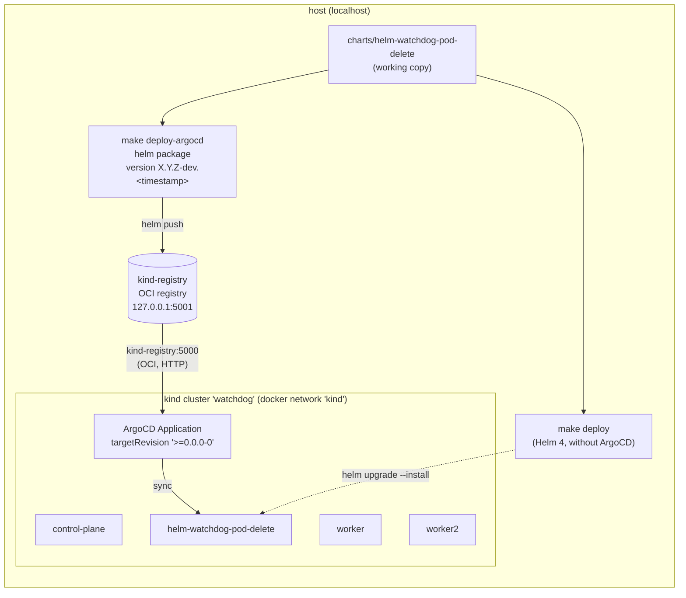

# Testing locally: kind + ArgoCD + local Helm chart

<!-- TOC -->

- [Testing locally: kind + ArgoCD + local Helm chart](#testing-locally-kind--argocd--local-helm-chart)
  - [Overview](#overview)
  - [Files](#files)
  - [Requirements](#requirements)
  - [Quick start (whole stack in one command)](#quick-start-whole-stack-in-one-command)
  - [Step by step](#step-by-step)
    - [1. Create the kind cluster](#1-create-the-kind-cluster)
    - [2a. Deploy the local chart WITHOUT ArgoCD (Helm 4)](#2a-deploy-the-local-chart-without-argocd-helm-4)
    - [2b. Deploy the local chart WITH ArgoCD](#2b-deploy-the-local-chart-with-argocd)
    - [3. Validate the watchdog](#3-validate-the-watchdog)
    - [4. Access the ArgoCD UI](#4-access-the-argocd-ui)
    - [5. Clean up](#5-clean-up)
  - [Automated tests](#automated-tests)
  - [Testing other Kubernetes versions](#testing-other-kubernetes-versions)
  - [Troubleshooting](#troubleshooting)

<!-- TOC -->

## Overview



- A kind cluster with 3 nodes (1 control-plane/master and 2 workers).
- A local OCI registry (`registry:3`) connected to the kind network. ArgoCD cannot read files from your disk, so the local chart is packaged with Helm 4 and pushed to this registry. Each push uses a unique pre-release version (`<Chart.yaml version>-dev.<timestamp>`), and the ArgoCD Application uses the semver constraint `>=0.0.0-0`, so ArgoCD always deploys the latest code of your working copy.
- ArgoCD installed with the official Helm chart.
- Without ArgoCD, the chart is installed directly from `charts/helm-watchdog-pod-delete` with Helm 4.

> Use only one deployment mode at a time (Helm **or** ArgoCD). The Makefile refuses to deploy with one mode while the other is active.

## Files

| File | Description |
|------|-------------|
| [kind/kind-cluster.yaml](kind/kind-cluster.yaml) | kind cluster with 1 control-plane and 2 workers |
| [helm/values-local.yaml](helm/values-local.yaml) | Values used to deploy the chart in kind (check interval of 10s) |
| [argocd/argocd-values.yaml](argocd/argocd-values.yaml) | Minimal values of the ArgoCD Helm chart (local tests only) |
| [argocd/repository-local-registry.yaml](argocd/repository-local-registry.yaml) | ArgoCD repository for the local OCI registry |
| [argocd/application.yaml](argocd/application.yaml) | ArgoCD Application that deploys the local chart |
| [test-crash-pods.yaml](test-crash-pods.yaml) | Pods that fail on purpose to validate the watchdog |
| [../tests/e2e.sh](../tests/e2e.sh) | End-to-end test script |

## Requirements

- Docker running (kind creates the nodes as containers).
- 4 CPUs and 8 GB of RAM available is recommended for the whole stack.
- The tools defined in [mise.toml](../mise.toml) (helm 4, kubectl, kind, ...). From the root of the repository:

```bash
make install-deps   # installs mise (if needed), the tools of mise.toml and the helm-unittest plugin
make check-deps     # checks if everything is installed
```

See [REQUIREMENTS.md](../REQUIREMENTS.md) for more details. Run `make help` to list all targets.

All commands below run from the **root of the repository**.

## Quick start (whole stack in one command)

```bash
make stack-up
```

It runs `kind-create` + `argocd-install` + `deploy-argocd`: creates the cluster and the local registry, installs ArgoCD, pushes the local chart and waits until the ArgoCD Application is `Synced` and `Healthy`.

Then:

```bash
make test-crash        # create pods with errors
make logs              # follow the watchdog logs (Ctrl+C to exit)
make argocd-ui         # ArgoCD UI in http://localhost:8080
make stack-down        # remove everything
```

## Step by step

### 1. Create the kind cluster

```bash
make kind-create
kubectl --context kind-watchdog get nodes
```

Expected:

```text
NAME                     STATUS   ROLES           AGE   VERSION
watchdog-control-plane   Ready    control-plane   1m    v1.37.0
watchdog-worker          Ready    <none>          1m    v1.37.0
watchdog-worker2         Ready    <none>          1m    v1.37.0
```

> All commands of the Makefile use the context `kind-watchdog` explicitly, so they never change other clusters configured in your kubeconfig.

### 2a. Deploy the local chart WITHOUT ArgoCD (Helm 4)

```bash
make deploy       # helm upgrade --install with examples/helm/values-local.yaml
make helm-test    # helm test: validates the RBAC permissions of the watchdog
```

After changing the chart, run `make deploy` again to upgrade the release.

To remove:

```bash
make undeploy
```

### 2b. Deploy the local chart WITH ArgoCD

```bash
make argocd-install   # installs ArgoCD (Helm chart argo-cd)
make deploy-argocd    # packages + pushes the local chart and applies the Application
```

Check the Application:

```bash
kubectl --context kind-watchdog -n argocd get applications
```

Expected:

```text
NAME                       SYNC STATUS   HEALTH STATUS
helm-watchdog-pod-delete   Synced        Healthy
```

After changing the chart, run `make deploy-argocd` again: a new version is pushed and ArgoCD syncs it.

To remove:

```bash
make undeploy-argocd    # deletes the Application and the resources of the chart
make argocd-uninstall   # (optional) removes ArgoCD
```

### 3. Validate the watchdog

```bash
make test-crash
make logs
```

Expected logs (the check interval is 10 seconds in `values-local.yaml`):

```text
2026-11-08T15:10:20Z [INFO] Starting the watchdog...
2026-11-08T15:10:20Z [INFO] Monitoring pods with errors...
2026-11-08T15:10:31Z [WARNING] Deleting pod: test-crash-error in namespace: test-crash (status: Error)
2026-11-08T15:10:41Z [WARNING] Deleting pod: test-crash-loop-5d9c7b8f4-x2x8k in namespace: test-crash (status: CrashLoopBackOff)
```

- `test-crash-error` is a bare Pod, so it is deleted and not recreated.
- `test-crash-loop` is managed by a Deployment, so the pod is deleted and recreated (and fails again, in a loop).

Remove the test pods:

```bash
make test-crash-clean
```

### 4. Access the ArgoCD UI

```bash
make argocd-password   # shows the password of the user "admin"
make argocd-ui         # port-forward to http://localhost:8080 (Ctrl+C to exit)
```

The port-forward listens only on `127.0.0.1`. To use another port: `make argocd-ui ARGOCD_PORT=9090`.

### 5. Clean up

```bash
make stack-down   # deletes the kind cluster and the local registry
```

## Automated tests

The same tests executed by the CI before publishing a release:

```bash
make test         # static tests: lint, template, unittest, kubeconform, shellcheck, actionlint, trivy, docs
make e2e          # requires the cluster: deploy with Helm + helm test + tests/e2e.sh + undeploy
make e2e-argocd   # requires the cluster and ArgoCD: deploy with ArgoCD + tests/e2e.sh
```

`tests/e2e.sh` checks that:

1. The watchdog Deployment is ready and runs as non-root.
2. A pod with status `Error` is deleted.
3. A failing pod of a Deployment (`Error`/`CrashLoopBackOff`) is deleted.
4. The watchdog never deletes pods of its own namespace and does not restart.

## Testing other Kubernetes versions

The chart supports Kubernetes >= 1.34. Use a node image of the kind version defined in `mise.toml` (list in https://github.com/kubernetes-sigs/kind/releases):

```bash
make kind-delete
make kind-create KIND_NODE_IMAGE=kindest/node:v1.34.11@sha256:44e222ee2132dab25ff87301682f89eb82c7880ea3a1bf543bfe9708fd08d67d
make e2e
```

## Troubleshooting

| Problem | Solution |
|---------|----------|
| `make check-deps` fails | Run `make install-deps` and activate mise in your shell: https://mise.jdx.dev/getting-started.html#activate-mise |
| `mise ERROR ... are not trusted` | Run `mise trust` in the root of the repository (`make install-deps` does it) |
| Port `5001` already in use | `make kind-create REGISTRY_PORT=5002` (use the same variable in `deploy-argocd`) |
| Port `8080` already in use | `make argocd-ui ARGOCD_PORT=9090` |
| Application `Unknown`/`ComparisonError` | `kubectl --context kind-watchdog -n argocd describe application helm-watchdog-pod-delete` and check if the registry is running: `docker ps --filter name=kind-registry` |
| `The chart is managed by ArgoCD` | Run `make undeploy-argocd` before `make deploy` |
| `The chart is deployed with Helm` | Run `make undeploy` before `make deploy-argocd` |
| Pods `Pending` | Check the resources of Docker: `kubectl --context kind-watchdog describe pod <pod> -n <namespace>` |
